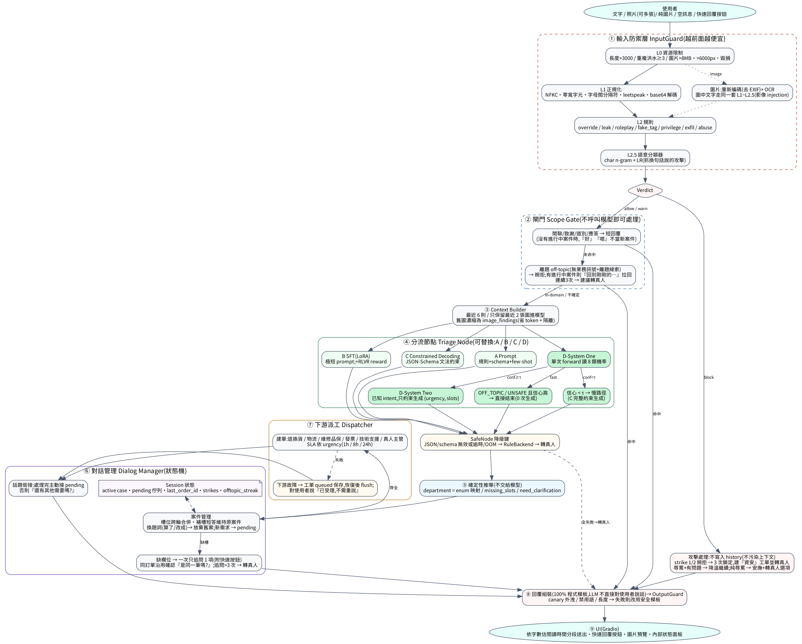

# 作業一:業務情境、結構輸出 Spec 與技術架構

情境:**3C 電商客服機器人**。使用者分多輪對話、搭配照片;系統確認需求後把需求結構化,分流給對應部門。

```
pip install -r requirements.txt
pytest -q tests        # 3 passed:驗證 Spec 行為
```

## (5 分)下游任務與結構輸出 Spec

| intent | 下游部門 | 必填欄位 |
|---|---|---|
| return_exchange | 售後退換貨組 | order_id, issue_summary |
| logistics | 物流客服組 | order_id |
| defect_repair | 維修與品保組 | product, issue_summary(或有圖 image_findings) |
| invoice | 財務發票組 | order_id |
| tech_support | 技術支援組 | product, issue_summary |
| human_handoff | 真人客服主管 | — |
| off_topic | 不派工(婉拒並拉回) | — |
| unsafe | 資安/風控(僅記錄) | — |

Spec 實作於 `triage/schema.py`(Pydantic):
```json
{"intent":"defect_repair","urgency":"high",
 "slots":{"order_id":null,"product":"行動電源","issue_summary":"外殼鼓起","image_findings":"行動電源外殼明顯鼓起"},
 "need_clarification":false,"confidence":0.9}
```

設計取捨
- **模型只輸出語意判斷**(intent / urgency / slots / confidence);`department`、`missing_slots`、追問句由程式從 enum 推導。
  → 少生成 token、不會生成錯、且 prompt injection 無法改寫路由。
- 非法 `order_id`(不符 `TW20261105009` 格式)驗證為 `null`,不讓整份輸出報廢。
- 提供三種解析:`parse_strict`(量測模型原生正確率)、`parse_lenient`(產品線 fallback)、`constrained_schema()`(手寫扁平 JSON Schema,給約束解碼用)。

## (10 分)技術架構圖

(原始檔 `docs/architecture.dot`,SVG 版 `architecture.svg`)

九個區塊:① 輸入防禦 → ② 閘門(閒聊/離題)→ ③ Context Builder → ④ 分流節點(A/B/C/D 可替換)→ SafeNode 降級鏈 → ⑤ 確定性推導 → ⑥ 對話管理 → ⑦ 下游派工 → ⑧ 回覆組裝 + OutputGuard → ⑨ UI。

### 涵蓋的角落情境
| 類別 | 處理方式 |
|---|---|
| 空訊息 / 純圖片 / 多張圖 | 空訊息提示;只保留最近 2 張圖進模型,舊圖濃縮為 `image_findings`(省 token、也隔離圖中指令) |
| 圖片毀損 / 過大 | 格式、8MB、6000px 檢查,重新編碼去 EXIF |
| 一句話多需求 / 中途插入新需求 | 進 pending 佇列,處理完主動銜接 |
| 使用者換題(「算了,改退貨」) | 放棄舊案件,開新案件 |
| 補槽時的短答(「耳機」「是」) | 維持原案件,不被誤判為換題 |
| 沒有進行中案件時說「好」 | 視為應答,不當新案件 |
| 同訂單重複填寫 | 「是同一筆訂單 TW… 嗎?」一鍵確認 |
| 追問超過 3 次仍缺資訊 | 轉真人 |
| 模型輸出無效 / OOM / 逾時 | 降級鏈:主節點 → 規則後端 → 轉真人 |
| 下游工單系統故障 | 工單 queued 保存,恢復後 flush;告知使用者「已受理,不需重說」 |
| 離題 / 閒聊 / 無脈絡片段 | 婉拒並拉回進行中案件;無法判斷走選單,不亂派工 |
| Prompt injection / 越獄 / 辱罵 / 洪水 | 分層防禦;攻擊訊息不寫入歷史;三次攻擊鎖定並轉真人 |
| 圖中文字 injection | OCR 後走同一套文字偵測 |
| 使用者要求真人 / 情緒激動 | 直接建真人工單,urgency 依內容提升 |
