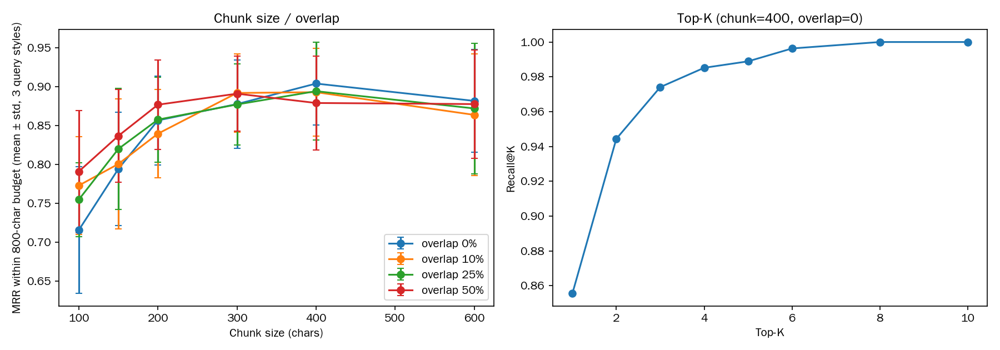
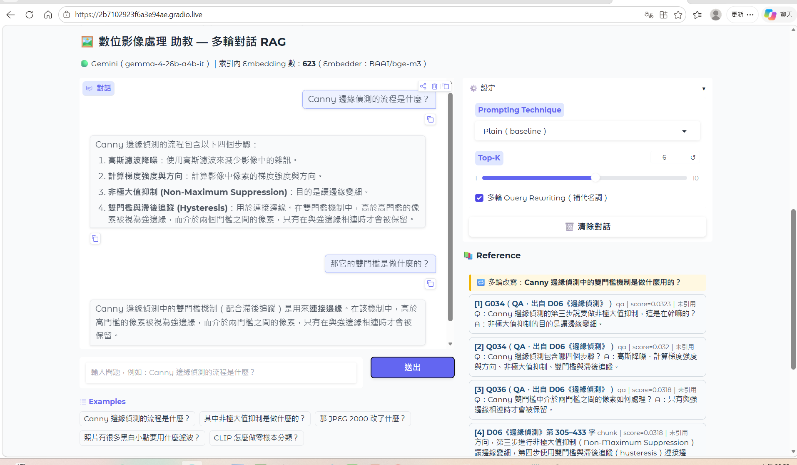
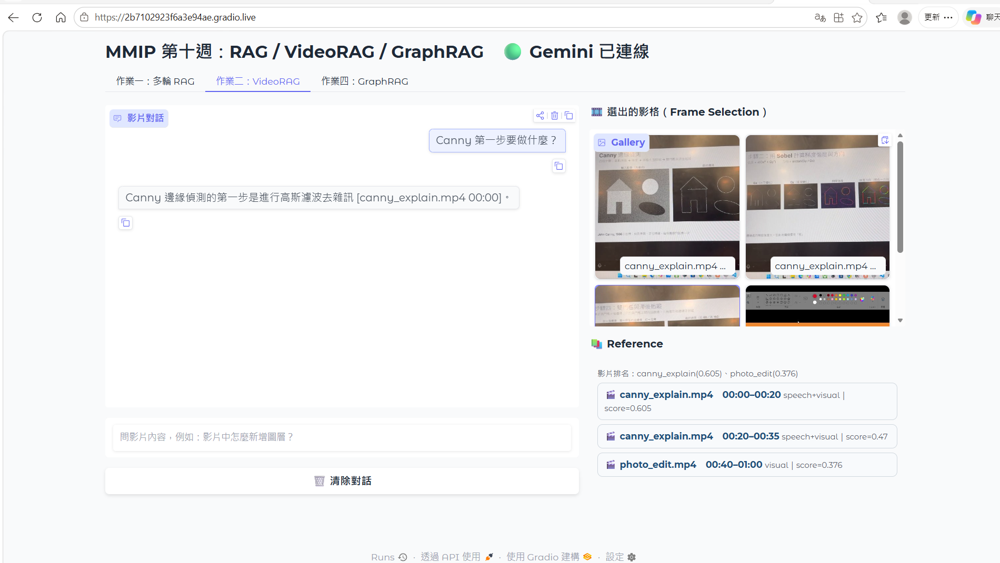
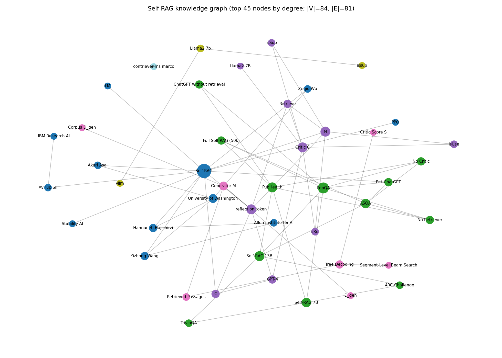
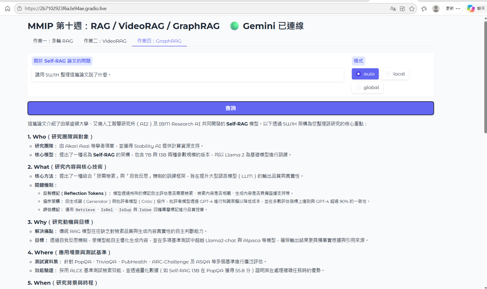

# MMIP 第十週作業：RAG / VideoRAG / RAG 評估 / GraphRAG

> 實驗模型：`gemma-4-26b-a4b-it`。所有數字由 `python run_all.py` 產生，本報告由 `make_report.py` 依 `results/` 自動生成。

| 作業 | 項目 | 配分 | 本報告章節 |
|---|---|---|---|
| 一 | 自製 QA Dataset（Embedding ≥ 200） | 5 | 1-1 |
| 一 | 多輪對話 RAG + Reference | 10 | 1-2 |
| 一 | 最穩定 Chunk/Overlap/Top-K | 5 | 1-3 |
| 一 | 最合適 Prompting | 5 | 1-4 |
| 一 | User Interface | 5 | 1-5 |
| 二 | 自錄 Video Corpus | 5 | 2-1 |
| 二 | 多輪 VideoRAG | 10 | 2-2 |
| 三 | RAGAS 評估作業一 | 10 | 3-1 |
| 三 | VideoRAG 評估方法 | 10 | 3-2 |
| 四 | 論文 Graph 化 | 5 | 4-1 |
| 四 | ≥20 題 Benchmark | 5 | 4-2 |
| 四 | GraphRAG 實作與評估 | 10 | 4-3 |

## 作業一：多輪對話 RAG

### 1-1 自製主題 QA Dataset（5 分）

- 主題：**數位影像處理**（與本課程 MMIP 相關），自行撰寫 20 篇講義式知識文件（`data/kb_image_processing.md`，共 8,423 字），涵蓋取樣量化、色彩空間、濾波、邊緣偵測、頻率域、形態學、分割、特徵、壓縮、復原、CNN、物件偵測、語意分割、ViT/CLIP、資料增強、品質評估。
- 手寫 QA：**120 組**（`data/qa_dataset.jsonl`），每組包含 正式問句、口語化問句、標準答案、**原文證據句**（程式自動檢查必為原文子字串）。
- 5W1H 擴充 QA：**117 組**（`data/qa_generated.jsonl`，依講義第 12 頁建議由 Gemini 以 5W1H 角度產生，證據句不在原文者自動丟棄）。
- **索引內 Embedding 總數 = 623**（文件 Chunk 149 + QA 問題向量 237 + QA 答案向量 237），超過門檻 200。Embedding 模型：`BAAI/bge-m3`。
- 檢索單位帶有座標資訊（文件編號、起訖字元位置、是否跨文件），回答時可精確指出 Reference。

範例：

| 編號 | 正式問句 | 口語化問句 | 標準答案 |
|---|---|---|---|
| Q001 | 數位影像是經過哪兩個步驟從類比影像得到的？ | 類比照片變成數位檔要經過哪些步驟 | 取樣與量化。取樣決定空間解析度，量化決定灰階解析度。 |
| Q025 | 卷積與相關的差別是什麼？ | convolution 跟 correlation 差在哪 | 卷積會先把核旋轉 180 度，對稱核兩者結果相同。 |
| Q049 | Otsu 方法如何選擇門檻？ | 大津法怎麼自動決定門檻 | 選擇使類間變異數最大的門檻值。 |
| Q073 | 影像退化模型通常如何表示？ | 影像被弄壞的數學模型長怎樣 | g = h * f + n，h 為點擴散函數，n 為加成性雜訊。 |
| Q097 | 語意分割與實例分割的差別？ | semantic 跟 instance segmentation 差在哪 | 語意分割不區分同類個體，實例分割要區分不同個體。 |

### 1-2 多輪對話 Context 經過 RAG 得到合理回覆與 Reference（10 分）

流程（講義第 8、9 頁兩階段）：

```
使用者追問 ──► Query Rewriting（LLM 依最近 3 輪對話補齊代名詞/省略的主詞）
           ──► 混合檢索：Dense Embedding + BM25（字元 n-gram）以 RRF 融合，QA 以 qa_id 去重
           ──► Top-K 參考資料（Chunk 與 QA，皆附出處座標）
           ──► System Prompt（角色、只能依參考資料、每句標 [編號]）+ 先前對話 + 參考資料 + 問題 ──► LLM
           ──► 回答 + Reference（UI 標示哪些 Reference 被實際引用）
```

10 段 × 3 輪測試對話（第 2、3 輪都含「它、那、其中」等指涉）完整紀錄見 `results/hw1_multiturn_demo.md`。**Reference 命中率：30/30 = 100.0%**

節錄（對話 M01）：

**第 1 輪｜使用者：** Canny 邊緣偵測的流程是什麼？  
**助教：** 根據參考資料，Canny 邊緣偵測包含以下四個步驟：

1. **高斯降噪**（以高斯濾波降噪）
2. **計算梯度強度與方向**
3. **非極大值抑制**（Non-Maximum Suppression，目的是讓邊緣變細）
4. **雙門檻與滯後追蹤**（hysteresis，用於連接邊緣）

<details><summary>Reference（✅ 命中標準答案來源）</summary>

- [1] Q034（QA，出自 D06《邊緣偵測》）（score 0.0325）：Q：Canny 邊緣偵測包含哪四個步驟？ A：高斯降噪、計算梯度強度與方向、非極大值抑制、雙門檻與滯後追蹤。…
- [2] G034（QA，出自 D06《邊緣偵測》）（score 0.0323）：Q：Canny 邊緣偵測的第三步說要做非極大值抑制，這是在幹嘛的？ A：非極大值抑制的目的是讓邊緣變細。…
- [3] D06《邊緣偵測》第 267–380 字（score 0.032）：Canny 邊緣偵測包含四個步驟：第一步以高斯濾波降噪，第二步計算梯度強度與方向，第三步進行非極大值抑制（Non-Maximum Suppression）讓邊緣變細，第四步使用雙門檻與滯後追蹤（hysteresis）連接邊緣。…
- [4] D06《邊緣偵測》第 192–342 字（score 0.031）：緣位置對應零交越點（zero crossing），但它對雜訊非常敏感，因此常先做高斯平滑，合稱 LoG（Laplacian of Gaussian）。Canny 邊緣偵測包含四個步驟：第一步以高斯濾波降噪，第二步計算梯度強度與方向，第三步進…
- [5] Q035（QA，出自 D06《邊緣偵測》）（score 0.0299）：Q：Canny 中非極大值抑制的目的是什麼？ A：讓邊緣變細。…
- [6] D06《邊緣偵測》第 305–433 字（score 0.0297）：方向，第三步進行非極大值抑制（Non-Maximum Suppression）讓邊緣變細，第四步使用雙門檻與滯後追蹤（hysteresis）連接邊緣。在 Canny 的雙門檻中，高於高門檻的像素是強邊緣，介於兩門檻之間的像素只有在與強邊緣相…

</details>

**第 2 輪｜使用者：** 其中非極大值抑制是做什麼的？  
🔁 改寫：Canny 邊緣偵測流程中的非極大值抑制（Non-Maximum Suppression）是做什麼的？  
**助教：** 根據資料 [1]、[2] 與 [3]，Canny 邊緣偵測流程中的非極大值抑制（Non-Maximum Suppression）的目的是**讓邊緣變細**。

<details><summary>Reference（✅ 命中標準答案來源）</summary>

- [1] G034（QA，出自 D06《邊緣偵測》）（score 0.0328）：Q：Canny 邊緣偵測的第三步說要做非極大值抑制，這是在幹嘛的？ A：非極大值抑制的目的是讓邊緣變細。…
- [2] Q035（QA，出自 D06《邊緣偵測》）（score 0.032）：Q：Canny 中非極大值抑制的目的是什麼？ A：讓邊緣變細。…
- [3] D06《邊緣偵測》第 267–380 字（score 0.0311）：Canny 邊緣偵測包含四個步驟：第一步以高斯濾波降噪，第二步計算梯度強度與方向，第三步進行非極大值抑制（Non-Maximum Suppression）讓邊緣變細，第四步使用雙門檻與滯後追蹤（hysteresis）連接邊緣。…
- [4] D06《邊緣偵測》第 305–433 字（score 0.0308）：方向，第三步進行非極大值抑制（Non-Maximum Suppression）讓邊緣變細，第四步使用雙門檻與滯後追蹤（hysteresis）連接邊緣。在 Canny 的雙門檻中，高於高門檻的像素是強邊緣，介於兩門檻之間的像素只有在與強邊緣相…
- [5] G091（QA，出自 D16《物件偵測》）（score 0.0306）：Q：什麼時候會用到非極大值抑制（NMS）機制？ A：NMS 會在保留信心分數最高的框時，刪除與它 IoU 超過門檻的其他重疊框。…
- [6] Q034（QA，出自 D06《邊緣偵測》）（score 0.0299）：Q：Canny 邊緣偵測包含哪四個步驟？ A：高斯降噪、計算梯度強度與方向、非極大值抑制、雙門檻與滯後追蹤。…

</details>

**第 3 輪｜使用者：** 那介於兩個門檻中間的點會怎麼處理？  
🔁 改寫：在 Canny 邊緣偵測的雙門檻與滯後追蹤步驟中，介於高門檻與低門檻中間的像素點會怎麼處理？  
**助教：** 根據上述資料，在 Canny 邊緣偵測的雙門檻中，介於兩門檻之間的像素**只有在與強邊緣相連時才會被保留**。

<details><summary>Reference（✅ 命中標準答案來源）</summary>

- [1] Q036（QA，出自 D06《邊緣偵測》）（score 0.0325）：Q：Canny 雙門檻中介於兩門檻之間的像素如何處理？ A：只有與強邊緣相連時才會被保留。…
- [2] D06《邊緣偵測》第 305–433 字（score 0.0325）：方向，第三步進行非極大值抑制（Non-Maximum Suppression）讓邊緣變細，第四步使用雙門檻與滯後追蹤（hysteresis）連接邊緣。在 Canny 的雙門檻中，高於高門檻的像素是強邊緣，介於兩門檻之間的像素只有在與強邊緣相…
- [3] Q034（QA，出自 D06《邊緣偵測》）（score 0.031）：Q：Canny 邊緣偵測包含哪四個步驟？ A：高斯降噪、計算梯度強度與方向、非極大值抑制、雙門檻與滯後追蹤。…
- [4] D06《邊緣偵測》第 358–494 字（跨 D07）（score 0.031）：與滯後追蹤（hysteresis）連接邊緣。在 Canny 的雙門檻中，高於高門檻的像素是強邊緣，介於兩門檻之間的像素只有在與強邊緣相連時才會被保留。
二維離散傅立葉轉換（DFT）把影像從空間域轉換到頻率域，低頻成分對應影像中緩慢變化的區域…
- [5] D06《邊緣偵測》第 267–380 字（score 0.0308）：Canny 邊緣偵測包含四個步驟：第一步以高斯濾波降噪，第二步計算梯度強度與方向，第三步進行非極大值抑制（Non-Maximum Suppression）讓邊緣變細，第四步使用雙門檻與滯後追蹤（hysteresis）連接邊緣。…
- [6] G034（QA，出自 D06《邊緣偵測》）（score 0.0299）：Q：Canny 邊緣偵測的第三步說要做非極大值抑制，這是在幹嘛的？ A：非極大值抑制的目的是讓邊緣變細。…

</details>

### 1-3 最穩定的 Chunk Size、Overlap、Top-K（5 分）

- 評分採講義第 10 頁的「繁中檢索能力評測」：正確段落排第 1 名得 1 分、第 2 名 1/2 分 … 前五名沒有得 0 分（MRR@5）。「正確段落」＝Chunk 覆蓋標準證據句 ≥80%。
- 只看 MRR@5 會偏好越大塊越好（大 Chunk 一定含答案，但送進 LLM 的雜訊與 token 也最多），因此再加上 **固定 800 字的 Context 預算**：K_budget = 800 / 平均 Chunk 長度，只計前 K_budget 名（MRR@budget）。
- 「穩定」：同一組參數在 **正式問句、口語問句、多輪追問（改寫後）** 三種提問風格下的平均要高、標準差要小，**穩定分數 = mean − std**；另以 bootstrap 估 95% 信賴區間。
- 知識庫以「連續講義」方式切塊（像切 PDF），所以大 Chunk 會跨越兩個主題而被稀釋。
- 掃描範圍：Chunk Size ∈ {100,150,200,300,400,600} 字 × Overlap ∈ {0,10,25,50}% × Top-K ∈ {1..10}。

穩定分數前 8 名（Embedder：`BAAI/bge-m3`，完整結果 `hw1_sweep_tfidf-char12.csv`）：

|   chunk_size |   overlap |   n_chunks |   K_budget |   MRRb_formal |   MRRb_colloquial |   MRRb_multiturn |   mean |   std |   stability |   ci95_low |   ci95_high |
|-------------:|----------:|-----------:|-----------:|--------------:|------------------:|-----------------:|-------:|------:|------------:|-----------:|------------:|
|      400.000 |     0.000 |     23.000 |      2.000 |         0.963 |             0.833 |            0.917 |  0.904 | 0.053 |       0.851 |      0.865 |       0.928 |
|      300.000 |   150.000 |     69.000 |      3.000 |         0.951 |             0.833 |            0.889 |  0.891 | 0.048 |       0.843 |      0.859 |       0.927 |
|      300.000 |    30.000 |     35.000 |      3.000 |         0.946 |             0.825 |            0.906 |  0.892 | 0.050 |       0.842 |      0.856 |       0.917 |
|      400.000 |    40.000 |     27.000 |      2.000 |         0.967 |             0.829 |            0.883 |  0.893 | 0.057 |       0.837 |      0.863 |       0.928 |
|      400.000 |   100.000 |     32.000 |      2.000 |         0.958 |             0.808 |            0.917 |  0.894 | 0.063 |       0.831 |      0.854 |       0.918 |
|      300.000 |    75.000 |     44.000 |      3.000 |         0.950 |             0.832 |            0.850 |  0.877 | 0.052 |       0.825 |      0.853 |       0.916 |
|      300.000 |     0.000 |     32.000 |      3.000 |         0.954 |             0.818 |            0.861 |  0.878 | 0.057 |       0.821 |      0.851 |       0.913 |
|      200.000 |   100.000 |    110.000 |      5.000 |         0.949 |             0.807 |            0.875 |  0.877 | 0.058 |       0.819 |      0.844 |       0.910 |



**結論：Chunk Size = 150、Overlap = 75、Top-K = 6。**
- 此設定 MRR@budget 平均 0.904、三種問法間標準差 0.053，為所有組合中最穩定。
- Top-K 依 Recall@K 曲線取「達到 Recall@10 的 95% 的最小 K」：K=1: 0.896、K=2: 0.956、K=3: 0.959、K=4: 0.982、K=5: 0.985、K=6: 0.985、K=8: 0.993、K=10: 0.996。
- 多輪追問若不做 Query Rewriting，MRR@5 平均下降 0.017（所有參數組合平均），證明改寫對多輪 RAG 是必要的。
- 各 Chunk Size 的最佳穩定分數：100 字 0.712、150 字 0.777、200 字 0.819、300 字 0.843、400 字 0.851、600 字 0.816。最佳落在中間的 400 字：太小（100 字）會把定義與條件切開，口語問句最不穩定；太大（600 字）會跨主題，在固定預算下只能放 1~2 塊，兩端都比中間差。

### 1-4 最合適的 Prompting Technique（5 分）

在相同檢索設定下比較 5 種 Prompt（`common/rag.py` 的 `PROMPTS`）：**Plain**（只給資料，baseline）、**Grounded**（角色＋只能依資料＋引用格式）、**CoT**（先列證據再回答）、**Few-shot**（示範一個引用式回答）、**Step-Back**（講義第 16~20 頁，先抽象出背景問題並一起檢索）。以作業三的 RAGAS 評審打分，綜合分數 = Faithfulness、Answer Relevancy、Answer Correctness 平均（Context 類指標由檢索決定，五者相同）。

| technique   |   faithfulness |   answer_relevancy |   answer_correctness |   multiturn_correctness |   avg_answer_chars |   score | judge   |
|:------------|---------------:|-------------------:|---------------------:|------------------------:|-------------------:|--------:|:--------|
| plain       |          1.000 |              0.801 |                0.859 |                   0.808 |             93.800 |   0.887 | llm     |
| fewshot     |          0.941 |              0.748 |                0.902 |                   0.963 |             62.000 |   0.864 | llm     |
| grounded    |          0.971 |              0.785 |                0.768 |                   0.707 |             88.400 |   0.841 | llm     |
| stepback    |          1.000 |              0.767 |                0.749 |                   0.670 |            116.700 |   0.839 | llm     |
| cot         |          1.000 |              0.764 |                0.749 |                   0.736 |            274.100 |   0.838 | llm     |

**結論：最合適的是 `plain`。**

### 1-5 User Interface（5 分）

`python app.py` 啟動 Gradio 介面（第一個分頁）：
- 左側聊天室支援多輪對話；右側即時顯示 **多輪改寫後的查詢**、每筆 **Reference 卡片**（出處座標、檢索分數、是否被回答引用）。
- 可即時切換 Prompting Technique、Top-K、是否啟用多輪改寫，一鍵清除對話；頁首顯示目前模型與索引 Embedding 數。
- 同一介面另有 VideoRAG（顯示選出的影格畫廊與時間戳）與 GraphRAG（顯示路由、種子實體與子圖）分頁。



## 作業二：多輪對話 VideoRAG

### 2-1 自錄 Video Corpus（5 分）

| 影片 | 長度 (秒) | 是否有說話 |
|---|---|---|
| canny_explain.mp4 | 35 | 有（講解） |
| photo_edit.mp4 | 79 | 沒有（操作） |

### 2-2 參考 VideoRAG 實作多輪對話聊天機器人（10 分）

依 Jeong et al., *VideoRAG: Retrieval-Augmented Generation over Video Corpus*（Findings of ACL 2025，講義第 56~63 頁）改編：

| 論文步驟 | 本作業做法（`hw2/videorag.py`） |
|---|---|
| 影片表示 | 1 fps 抽影格；語音轉逐字稿（本機 Whisper 或 Gemini 音訊理解，靜音影片自動標記為 silent） |
| Frame Selection（CLIP → K-means → 代表影格） | 影格 → CLIP 向量（無 CLIP 時用色彩直方圖+縮圖）→ K-means，每分鐘約 8 群，取最接近群中心的影格；再由 Gemini 為關鍵影格寫畫面描述（含畫面文字、操作） |
| Action 1：找到相關影片 | 影片切成 20 秒片段（逐字稿＋畫面描述）做 Embedding；以片段最高分代表影片分數排序影片 |
| Action 2：選出最相關影格（論文以 MLP 對 40 組隨機組合打分） | 沒有訓練資料，改為「畫面描述/CLIP 與問題的相似度」＋ MMR 去重，挑 4 張 |
| Action 3：生成 | 影格圖片＋逐字稿片段＋對話歷史 → Gemini 多模態生成，每個陳述標註 [影片 mm:ss] |
| （新增）多輪對話 | 與作業一相同的 Query Rewriting，讓「那下一步呢？」能找到正確片段 |

沒有說話的操作影片，逐字稿為空，完全依靠關鍵影格的畫面描述與影格圖片回答；有說話的影片則語音與畫面互補。模態消融結果見作業三進階。



## 作業三：評估 RAG 系統

### 3-1 以 RAGAS 評估作業一（10 分）

依 RAGAS 論文（講義第 66~69 頁）實作於 `common/ragas_metrics.py`：Faithfulness、Answer Relevancy、Context Relevancy 三項 reference-free 指標，加上利用自製 QA 標準答案的 Context Precision、Context Recall、Answer Correctness。評估集：20 題口語問句（單輪）＋ 10 段 × 3 輪多輪對話（共 50 筆），多輪題以改寫後的獨立問題交給評審。

最佳設定（chunk=150、overlap=75、top-k=6、prompt=`plain`）：

| setting   |   faithfulness |   answer_relevancy |   context_relevancy |   context_precision |   context_recall |   answer_correctness |
|:----------|---------------:|-------------------:|--------------------:|--------------------:|-----------------:|---------------------:|
| multiturn |          1.000 |              0.811 |               0.251 |               0.859 |            1.000 |                0.846 |
| single    |          0.975 |              0.761 |               0.208 |               0.754 |            0.883 |                0.741 |
| overall   |          0.990 |              0.791 |               0.234 |               0.817 |            0.953 |                0.804 |

多輪對話消融（關閉 Query Rewriting）：

|                    |   有改寫 |   無改寫 |    差異 |
|:-------------------|------:|------:|------:|
| faithfulness       | 1.000 | 1.000 | 0.000 |
| answer_relevancy   | 0.811 | 0.766 | 0.045 |
| context_relevancy  | 0.251 | 0.248 | 0.002 |
| context_precision  | 0.859 | 0.817 | 0.041 |
| context_recall     | 1.000 | 1.000 | 0.000 |
| answer_correctness | 0.846 | 0.822 | 0.023 |

解讀：Faithfulness 反映回答是否忠於檢索資料（幻覺程度）；Context Recall 高代表檢索幾乎都拿到了答案所需資訊；Context Relevancy 天生偏低，因為它計算的是「必要句子 / 全部句子」，Top-K 段落中本來就有大量和問題無關的句子，這也是講義第 69 頁指出不同 Context Relevance 定義差異的原因。逐題明細在 `results/hw3_ragas_*.jsonl`。

### 3-2 延伸 RAG 評估手段來評估 VideoRAG（10 分）

文字 RAGAS 只看文字 Context；VideoRAG 多了「找錯影片、找錯時間、挑錯影格」三種失敗，而且答案可能只存在畫面中。因此設計四層評估（`hw3/eval_video.py`）：

| 層級 | 指標 | 對應的 RAGAS 概念 |
|---|---|---|
| A. 影片檢索 | Video Hit@1、Video MRR | Context Precision（影片層級） |
| B. 時間定位 | Segment Hit@K、Best tIoU（取回片段與標準時間區間的時間 IoU） | Context Recall（時間軸） |
| C. 影格選取 | Frame Temporal Precision（影格落在標準區間 ±5 秒）、Frame Relevance Precision（多模態 LLM 看圖判斷影格是否有用） | 視覺版 Context Precision / Relevance |
| D. 生成 | Multimodal Faithfulness（評審同時看逐字稿與影格判斷陳述是否被支持）、Answer Relevancy、Answer Correctness | Faithfulness 等 |

標準答案由 Gemini 看 **完整影片**（不經過我們的抽影格流程，避免同一套偏差）出題並標時間區間，再經人工檢查修正（`data/video_qa.json`）。另做兩種分析：**模態消融**（完整 / 只有語音 / 只有畫面）與 **依題目所需模態、影片類型（有/無說話）、對話輪次分組**。

模態消融（依 mode）：

| mode        |   video_hit1 |   video_mrr |   segment_hit |   best_tiou |   frame_temporal_precision |   frame_relevance_precision |   mm_faithfulness |   answer_relevancy |   answer_correctness |
|:------------|-------------:|------------:|--------------:|------------:|---------------------------:|----------------------------:|------------------:|-------------------:|---------------------:|
| full        |        1.000 |       1.000 |         0.750 |       0.127 |                      0.250 |                       0.406 |             1.000 |              0.808 |                0.792 |
| speech_only |        0.875 |       0.938 |         0.750 |       0.127 |                    nan     |                     nan     |             0.500 |              0.393 |                0.458 |
| visual_only |        1.000 |       1.000 |         0.750 |       0.127 |                      0.281 |                     nan     |             1.000 |              0.777 |                0.833 |

依題目所需模態（full）：

| needs   |   video_hit1 |   video_mrr |   segment_hit |   best_tiou |   frame_temporal_precision |   frame_relevance_precision |   mm_faithfulness |   answer_relevancy |   answer_correctness |
|:--------|-------------:|------------:|--------------:|------------:|---------------------------:|----------------------------:|------------------:|-------------------:|---------------------:|
| speech  |        1.000 |       1.000 |         1.000 |       0.221 |                      0.417 |                       0.250 |             1.000 |              0.891 |                0.889 |
| visual  |        1.000 |       1.000 |         0.600 |       0.070 |                      0.150 |                       0.500 |             1.000 |              0.759 |                0.733 |

依影片是否有說話（full）：

| video_has_speech   |   video_hit1 |   video_mrr |   segment_hit |   best_tiou |   frame_temporal_precision |   frame_relevance_precision |   mm_faithfulness |   answer_relevancy |   answer_correctness |
|:-------------------|-------------:|------------:|--------------:|------------:|---------------------------:|----------------------------:|------------------:|-------------------:|---------------------:|
| False              |        1.000 |       1.000 |         0.500 |       0.038 |                      0.125 |                       0.562 |             1.000 |              0.781 |                0.667 |
| True               |        1.000 |       1.000 |         1.000 |       0.216 |                      0.375 |                       0.250 |             1.000 |              0.835 |                0.917 |

依對話輪次（full）：

|   turn |   video_hit1 |   video_mrr |   segment_hit |   best_tiou |   frame_temporal_precision |   frame_relevance_precision |   mm_faithfulness |   answer_relevancy |   answer_correctness |
|-------:|-------------:|------------:|--------------:|------------:|---------------------------:|----------------------------:|------------------:|-------------------:|---------------------:|
|      1 |        1.000 |       1.000 |         1.000 |       0.138 |                      0.250 |                       0.375 |             1.000 |              0.806 |                1.000 |
|      2 |        1.000 |       1.000 |         0.500 |       0.116 |                      0.250 |                       0.438 |             1.000 |              0.810 |                0.583 |

## 作業四：GraphRAG

### 4-1 將 AI 論文 Graph 化（5 分）

論文：**Self-RAG: Learning to Retrieve, Generate, and Critique through Self-Reflection**（Asai et al., ICLR 2024，arXiv:2310.11511，講義第 31~44 頁）。

建圖流程（`hw4/graphrag.py`）：論文切成 1,200 字段落 → LLM 依指定 schema 抽取實體（Method/Model/Token/Dataset/Metric/Person/Organization/Result…）與關係（trained_on、outperforms、scores、has_value、affiliated_with…，數字結果寫進關係描述）→ 名稱正規化後合併成 networkx 有向多重圖 → Louvain 社群偵測 → LLM 為每個社群寫摘要（Microsoft GraphRAG 的 community report）。可匯出 GraphML（Gephi）與 Cypher（Neo4j，講義第 54 頁）。

- 節點 **84**、邊 **81**、社群 **6**（建圖模型：`gemini-3.1-flash-lite`）



### 4-2 Benchmark（5 分）

`data/graphrag_benchmark.json` 共 **24 題**：local 10 題（單一事實/數字）、multihop 8 題（需串兩個以上實體，例如「哪位作者不在 UW、屬於哪個機構」）、global 6 題（整體性問題，例如講義第 48 頁的「請用 5W1H 整理這篇文章」）。每題有標準答案與關鍵詞清單（可含同義詞）。

### 4-3 實作 GraphRAG 並評估（10 分）

- **Local search**（講義第 53 頁）：問題 → 名稱比對＋Embedding 找種子實體 → 沿關係走 2 步 → 以關係描述與問題相似度保留 40 條邊 → 子圖三元組＋實體描述＋來源段落交給 LLM。
- **Global search**：各社群摘要先 map（抽出相關重點並打分）再 reduce（整合成答案）。
- **Router**：LLM 判斷問題屬於 local 或 global。
- 比較對象：No-RAG（LLM 直接回答）、Vanilla RAG（論文切 500 字、混合檢索 Top-5）。
- 指標：Key-point Recall（關鍵詞命中率，不依賴 LLM）、LLM-Judge Correctness（0~5 分正規化）、Router Accuracy。

整體：

| system      |   keypoint_recall |   judge_score |
|:------------|------------------:|--------------:|
| graphrag    |             0.685 |         0.775 |
| no_rag      |             0.470 |         0.642 |
| vanilla_rag |             0.661 |         0.858 |

依題型：

```
            judge_score                keypoint_recall                
type             global local multihop          global  local multihop
system                                                                
graphrag          0.733   0.7    0.900           0.569  0.620    0.854
no_rag            0.800   0.6    0.575           0.431  0.545    0.406
vanilla_rag       0.667   0.9    0.950           0.347  0.770    0.760
```



Router Accuracy：**0.875**

解讀（以 judge_score）：local 題 GraphRAG 低於 Vanilla RAG（-0.200）；multihop 題 GraphRAG 低於 Vanilla RAG（-0.050）；global 題 GraphRAG 高於 Vanilla RAG（+0.067）。Global 題的差距最能說明 GraphRAG 的價值：社群摘要涵蓋整篇論文，而 Top-K 段落只看得到局部，正是講義第 48~52 頁所說「RAG 回答不了」的問題型態。Local 題 Vanilla RAG 較好，因為答案就在一段原文裡，抽成三元組反而可能遺漏細節（例如數字的上下文）。
逐題答案與評審理由見 `results/hw4_benchmark_answers.jsonl`。

## 重現方式

```bash
pip install -r requirements.txt
cp .env.example .env   # 填入 GEMINI_API_KEY
python run_all.py       # 全部實驗 + 產生報告
python app.py           # 開啟 UI
```
